

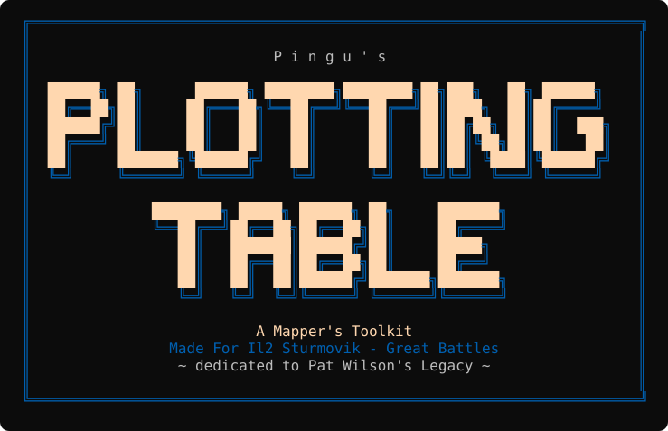

**Fly IL-2 Great Battles over anywhere on Earth.**

**Pingu's Plotting Table: A Mapper's Toolkit** turns a real place into an IL-2 Great Battles map pack, then builds a campaign on it for you to fly.

*Made for IL-2 Sturmovik: Great Battles. Dedicated to Pat Wilson's legacy.*

[Download](../../releases/latest) · [Quick start](#quick-start) · [What it does](#what-it-does) · [A look around](#a-look-around) · [FAQ](#faq) · [User guide](docs/USER_GUIDE.md) · [Buy me a coffee](https://buymeacoffee.com/pingu565)

    

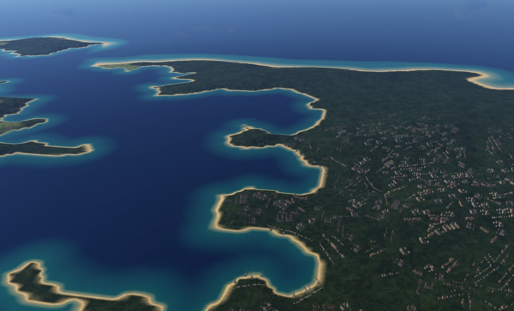

A real coastline with its towns and sea floor, baked from open data and seen in game.

---

## Welcome aboard

Ever wanted to fight over your home town, a coastline you know, or a corner of the war the game never covered? That's what the Plotting Table is for.

You drag a box over a real place on a map, choose a few options and press **Lift off**. The Plotting Table downloads open elevation and map data for that area, bakes it onto one of the maps you already own, and gives you a ready-to-enable mod pack. That pack carries terrain, coast, rivers, forests, roads, railways, towns and airfields. It also carries a **dynamic campaign**: the game's own career mode and Advanced Quick Missions, with your squadrons, front lines and map art. PWCG can fly from it too.

It's built for:

- **Campaign builders** who want to fly a "what if" or a forgotten theatre on real ground.
- **Mission makers** who want a fresh map with real airfields, open in the game's own editor.
- **Anyone curious** to see their own part of the world from a cockpit.

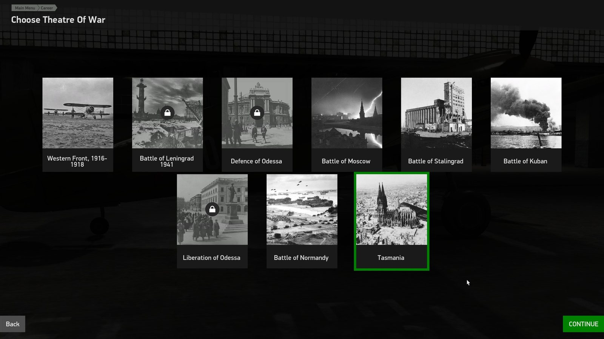

Your map shows up as a new theatre in the game's own career mode.

## What it does

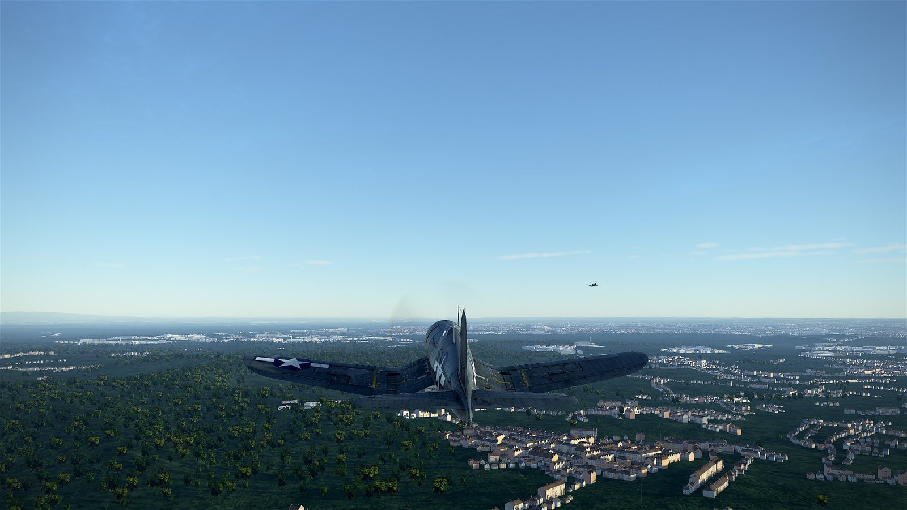

**Real-world terrain**
- Heights from Copernicus GLO-90, a smooth coastline and a real sea floor from NOAA ETOPO.
- Rivers and lakes carved from OpenStreetMap. Forests and land cover from ESA WorldCover.
- Roads, railways and bridges from OpenStreetMap, with a bridge on every crossing and stations on the line.
- Towns rebuilt at the real places, with buildings set along the streets.
- Airfield strips you place yourself, flattened and cleared, and moved to dry flat ground if one lands on water or a cliff.

 

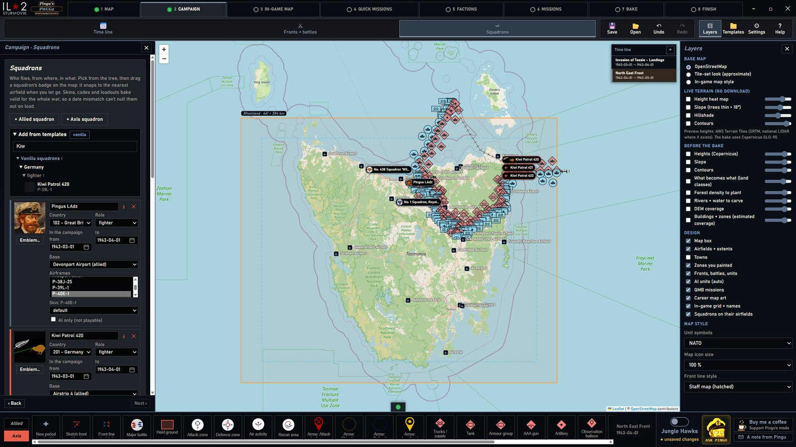

**A campaign to fly on it**
- Phases first, then a guided front-line pipeline for each phase, in order: front line, plan, objectives, battles.
- A Hearts of Iron style plan: a proposed front for each phase's end and curved, tapered thrust arrows, drawn point by point or with a pen. They go onto the career's strategic map too.
- Optional auto objectives from cities, airfields, bridges, rail junctions and high ground near the front.
- Factions you define: who fights, from when, on which side, with which airframes and default skins.
- Squadrons with schedules: base moves by date, with a warning if a field is in enemy hands that day.
- Career map art in the Jungle Hawks style: front bands, arrows, routes, landings and labels.
- Seasons that follow the real date, including southern-hemisphere maps, plus weather presets for the career's daily weather.
- Formation styles for flights and ground groups, such as column, wedge, echelon and finger-four, with Auto fill and Auto move to populate a mission.
- Quick missions, the career, Advanced Quick Missions and a PWCG overlay, all flying from the same strips.

 

**Friendly to use**
- A native window with numbered tabs that take you from scenario and map, through campaign and factions, to bake and finish.
- **Ask Pingu** walks you through every step, in Plain English, In the Game or Under the Hood.
- **Refine** rebakes only the parts you changed.
- A mission editor and the game's own editor, both inside the app.
- **Jungle Hawks** is detected automatically: its planes, countries, squadrons and skins switch on when it's installed.
- PRISM and HSDSync skin tools open inside the app. They're downloaded on first use, never shipped.
- The GUI comes in English, German, French, Italian, Polish, Russian, Turkish, Simplified Chinese and Japanese.

## A look around

| | |
|---|---|
| 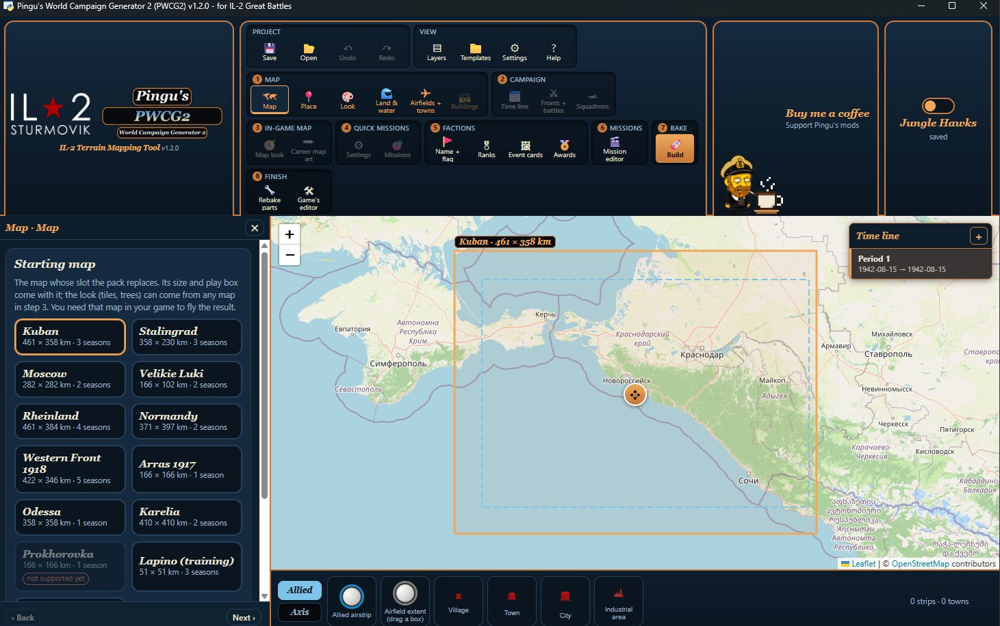 | 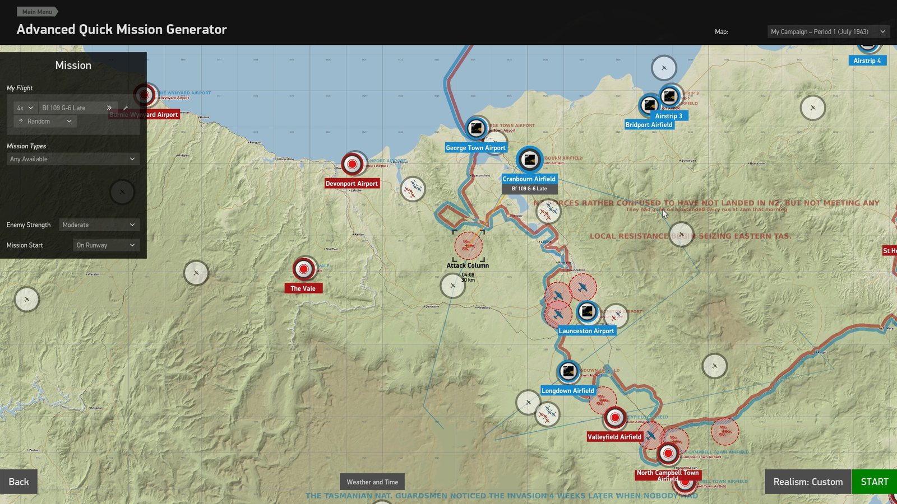 |
| **Map tab.** Pick a starting map and drag its true-size box over a real place. | **Advanced Quick Missions** on your own fronts and airfields. |
| 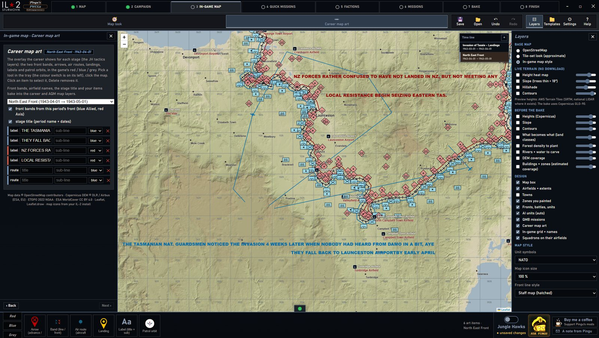 | 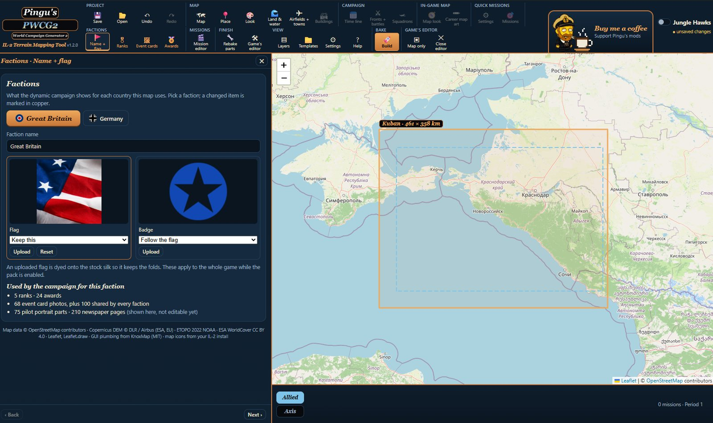 |
| **In-game map.** Career map art for every stage of the campaign. | **Factions.** Names, flags, badges, ranks and awards. |
| 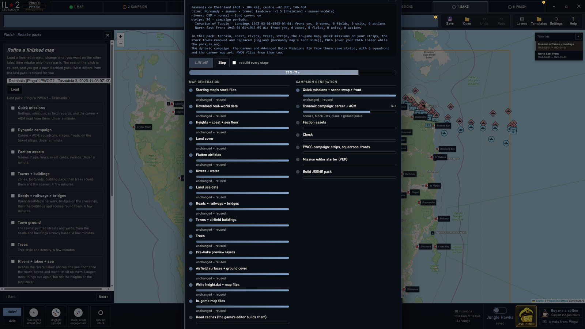 | 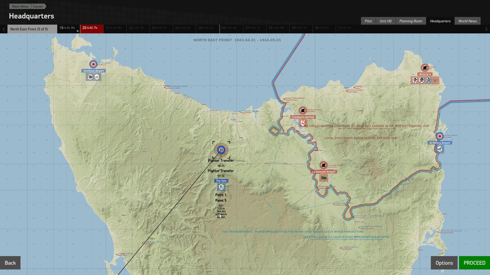 |
| **Bake.** Every stage has its own progress bar, and unchanged stages are reused. | **In game.** Career Headquarters on the finished map. |

## What you need

- **Windows 10 or 11** with Microsoft Edge WebView2. It comes with current Windows.
- **IL-2 Sturmovik: Great Battles**, plus the map you build on. The result swaps that map's terrain, so you need to own it.
- **Python: nothing to install yourself.** The Plotting Table runs on **Python 3.13** only, and `installer.bat` sets that up: it uses a Python 3.13 your PC already has, or downloads a private copy (about 15 MB, python.org's own Windows build from nuget.org, checked byte for byte) into the Plotting Table's `.python` folder. Python 3.14 or newer as your main Python is fine: it stays as it is.
- **JSGME**, or any mod enabler that handles the game's `MODS` folder, to switch packs on and off.
- **Disk space and an internet connection** for the first build of an area. Map data downloads once per region and stays on disk, for example about 720 MB for Malta and 5 GB for the Rheinland.
- Optional: **PWCG** to fly PWCG campaigns on your map, and **Jungle Hawks** for its Pacific planes, squadrons and jungle look.

Nothing from the game ships with the Plotting Table. It reads what it needs from your own install the first time it starts, and nothing in the game folder changes.

## Quick start

1. **Get the Plotting Table.** Download `Pingus-Plotting-Table-Release1.1.zip` from [Releases](../../releases/latest) and unzip it anywhere. This repository holds the documentation and pictures; the program itself comes as that zip.
2. **Run `installer.bat`.** The first start sets up its own Python 3.13 environment (with a private Python 3.13 if your PC has none), which takes a few hundred MB and a few minutes. After that, open the Plotting Table from the `Pingu's PT Installer` shortcut it creates, with no terminal window. The setup window names each step and each file as it downloads.
3. **Let it read your game.** On first start it asks for your language, finds your IL-2 install, and reads its maps, planes and skins once.
4. **Make a map.** In the Map tab, pick a starting map, drag the box over your place, choose the look, and add airfield strips.
5. **Set up the campaign.** Define your factions and dates in Scenario, then fronts and squadrons in Campaign. **Ask Pingu**, bottom right, explains each step.
6. **Bake.** Press **Lift off** (Ctrl+B). The pack lands in `<game>\MODS\<Map Name> [Pingu'sPTv1.1]` as a new, disabled folder (the number after `v` is the app's version; a rebuild of the same map is `<Map Name> 2 [Pingu'sPTv1.1]`).
7. **Fly.** Close IL-2 and its editor, enable the pack last in JSGME, then start the game. Your map is a new career theatre and quick-mission setting.

Run `installer.bat` again after each update, because it installs any new libraries. The [user guide](docs/USER_GUIDE.md) has every tab, option and file in detail.

## Good to know

- **Multiplayer needs the same pack everywhere.** Every pack carries a dedicated-server kit (`<Map Name> server [Pingu'sPTv1.1]`). The server and every player need the same pack, and each player must own the base map. It is not yet tried on a real dedicated server.
- **Roads are modern.** The road and rail network comes from today's OpenStreetMap, not 1942's.
- **PWCG has fixed limits.** PWCG's own program fixes map area, front dates and ground troops, so a pack can't change them.
- **Fly each new map once.** The build checks the pack's files, but only the game can confirm it all loads.
- **Prokhorovka** can't be used as a starting map yet, because of its finer 12.5 m grid.

## FAQ

<b>Do I need to own the map I build on?</b>

Yes. A pack swaps the terrain of one of your maps (Kuban, Stalingrad, Normandy and so on), so you need that map in your game to fly the result. The Map tab shows each map's size and which PWCG dates it supports.

<b>Does the Plotting Table include any of the game's files?</b>

No. The Plotting Table is scripts only. Everything it needs from IL-2 is read from your own install the first time it starts, and the release build refuses to package any file that matches the game. Packs you build do contain material derived from your game, so check the game's terms before sharing one.

<b>I have Python 3.14. Will it run?</b>

Yes. The Plotting Table is built and tested on Python 3.13, so it never runs on 3.14 or newer. `installer.bat` looks for a Python 3.13 on your PC and, when there is none, downloads a private copy into the Plotting Table's own `.python` folder (nothing is installed on the PC and your main Python is left alone). An old `.venv` made with another version is rebuilt by itself. If the download can't happen, the window says what to do: check the connection, or run `py install 3.13` with Python 3.14's install manager, then run `installer.bat` again.

<b>Can I fly my map in multiplayer?</b>

Yes, on a dedicated server, though it is not yet tried on a real one. Every pack carries a kit at its root, `<Map Name> server [Pingu'sPTv1.1]`, with the same GB Mod Loader 1.5.0 (`winmm.dll` + `GBML.dll`; it runs under `DServer.exe` too), the SHA-256 of every map file, and `Check map files.bat`.

1. **Server:** enable the same pack in the server's IL-2 install with JSGME (its `bin\game` already holds the loader) and turn Mods ON in `startup.cfg`.
2. **Every player:** enable the same pack (same name and number), with no other GB Mod Loader plugins than the server's: the loader's handshake kicks a player whose mod set differs, and the map plugin only acts online in a verified session. You need to own the base map: the map plugin only lets the new terrain in when your own account unlocks that map.
3. **Everyone:** run `Check map files.bat`. It must say OK on the server and on every PC. If one install's files differ, that player flies over different ground.

Build the pack once and share that folder, because a rebuild is a different pack. The [user guide](docs/USER_GUIDE.md#multiplayer-and-dedicated-servers) has the details. No plugin in a pack hooks or reads the game's `common.dll`.

<b>Will it break my game?</b>

No. Nothing in the game folder changes when you build. A pack is a new, disabled folder in `MODS`: enable it in JSGME to fly it, disable it to get the stock map back.

<b>How long does a build take, and how much does it download?</b>

The first build of an area downloads its map data once, for example about 720 MB for Malta or 5 GB for the Rheinland, and keeps it on disk. After that, a full bake takes minutes, and **Refine** only rebakes the stages you changed.

<b>Do I need Jungle Hawks or PWCG?</b>

No, both are optional. If Jungle Hawks is installed, the Plotting Table detects it and uses its planes, countries, squadrons and jungle look. If PWCG is installed, the pack carries a PWCG campaign on the same airfields as the career.

<b>Does it work south of the equator?</b>

Yes. Seasons follow the real date and latitude, so a Tasmanian August gets winter ground, winter skies and a winter snow line.

<b>Why are the roads modern?</b>

Roads, railways and towns come from today's OpenStreetMap, because no worldwide 1940s dataset exists. You can paint zones and move towns yourself in the Map tab.

<b>Can I skin my squadrons?</b>

Yes. Each faction has default skins, and the Scenario tab opens **PRISM** (skin editor) and **HSDSync** (skin downloader) inside the app. Neither ships with the Plotting Table: they're fetched from their own pages, or taken from your Downloads folder, the first time you use them.

<b>Where are my files?</b>

Jobs, downloads and caches live in `%LOCALAPPDATA%\LocationLiftoff`. Templates and missions go to `Documents\Pingu's Plotting Table`. Packs go to your game's `MODS` folder. Settings lets you change each of these.

<b>Something went wrong. What now?</b>

Ask Pingu (bottom right) covers each step. If a build fails, its log is in the job's work folder, and the build window says which stage stopped. Please open an [issue](../../issues) with that log and what you were doing.

## Support

The Plotting Table is free. If it gives you a good flight, you can [buy Tomsen a coffee](https://buymeacoffee.com/pingu565) to support Pingu's mods. Bug reports and ideas are just as welcome in [Issues](../../issues).

## Credits

- **Pingu's Plotting Table: A Mapper's Toolkit** is made by **Pingu**, © 2026 [Off Shell Instruments Pty Ltd](https://offshellinstruments.com/).
- **PWCG** is Pat Wilson's Campaign Generator. The Plotting Table is dedicated to his legacy, and isn't affiliated with PWCG.
- **IL-2 Sturmovik: Great Battles**: the Plotting Table is made with the full endorsement and support of the game's developers.
- **Jungle Hawks** terrain pipeline, by Pingu, does the baking under the hood.
- Map data: © [OpenStreetMap](https://www.openstreetmap.org/copyright) contributors, ODbL, with regional extracts from [Geofabrik](https://download.geofabrik.de/).
- Elevation: Copernicus DEM GLO-90 © DLR e.V. 2010-2014 and © Airbus Defence and Space GmbH 2014-2018, provided under COPERNICUS by the European Union and ESA.
- Sea floor: NOAA NCEI ETOPO 2022, public domain. Land cover: ESA WorldCover 2021 v200, CC BY 4.0.
- GB Mod Loader: Dusty.
- Libraries: [Leaflet](https://leafletjs.com/) (BSD-2-Clause) and Leaflet.draw (MIT).

## Licence

Pingu's Plotting Table: A Mapper's Toolkit is **closed-source software in open beta**, © 2026 Off Shell Instruments Pty Ltd, all rights reserved. It's free to download and use for personal, non-commercial beta testing of IL-2 Great Battles map packs. Please don't redistribute, modify, reverse engineer or sell it: point people to the official download instead. It comes as is, with no warranty, and the beta may change or be withdrawn at any time. Bug reports and ideas are very welcome, and may be used freely. The full terms are in [LICENSE](LICENSE).

Bundled libraries, GB Mod Loader and map data aren't Off Shell Instruments' and keep their own licences, listed in [NOTICE.md](NOTICE.md). IL-2 Great Battles and everything read from it belong to their owners. Packs you build contain material derived from your game, so check the game's terms before sharing one.

**Happy hunting, and blue skies.**

