# Screenshots

| | |
|---|---|
| 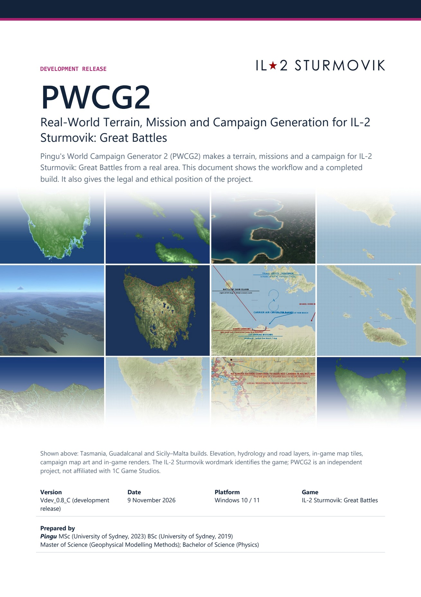 | Cover |
| 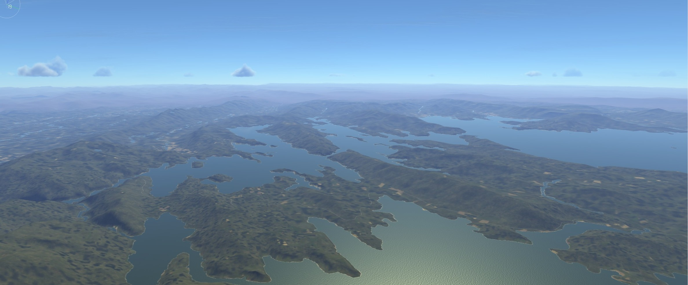 | Tasmania in the 3D editor |
| 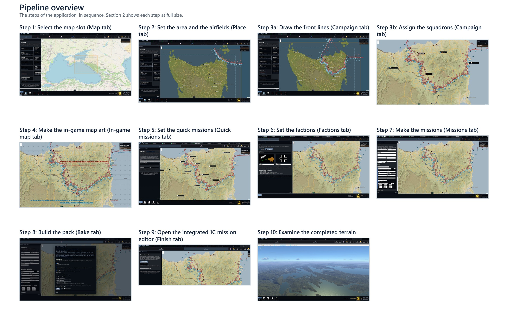 | From a real place to a map pack |
|  | Place tab |
| 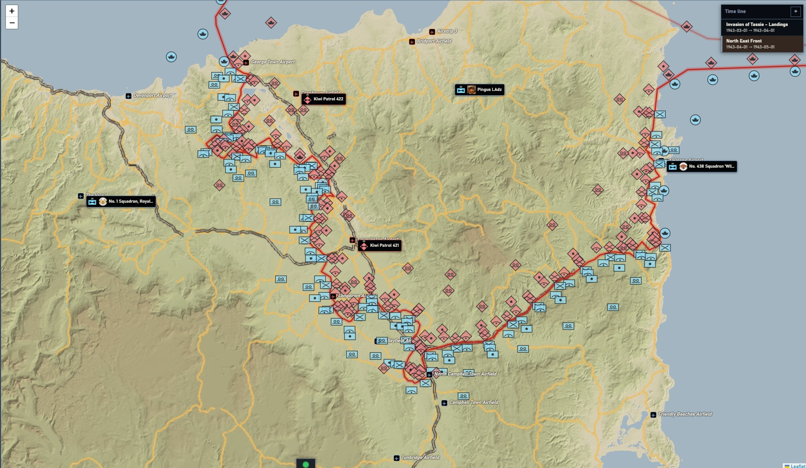 | Campaign squadrons |
| 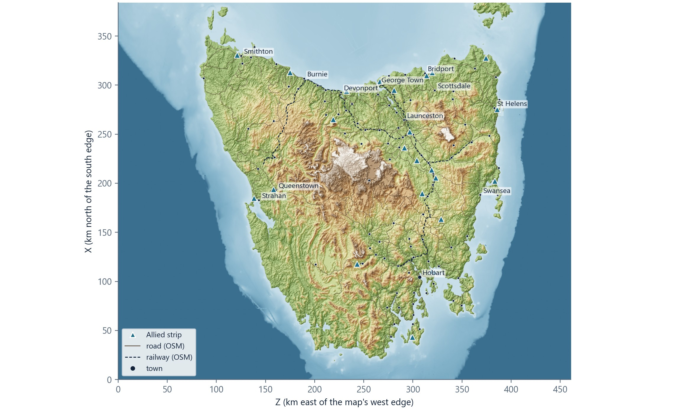 | Tasmania terrain |
| 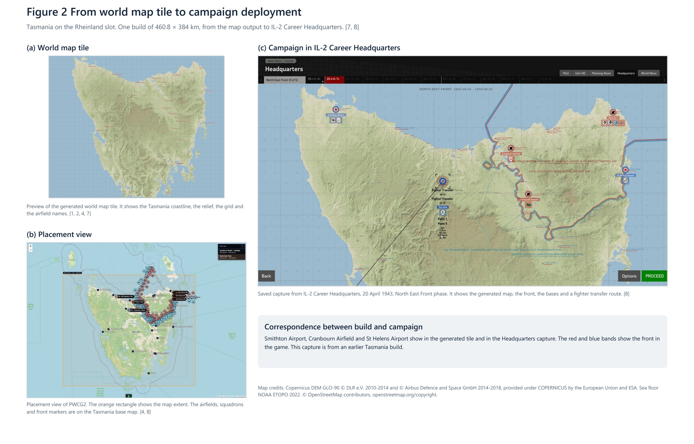 | From map tile to career headquarters |
| 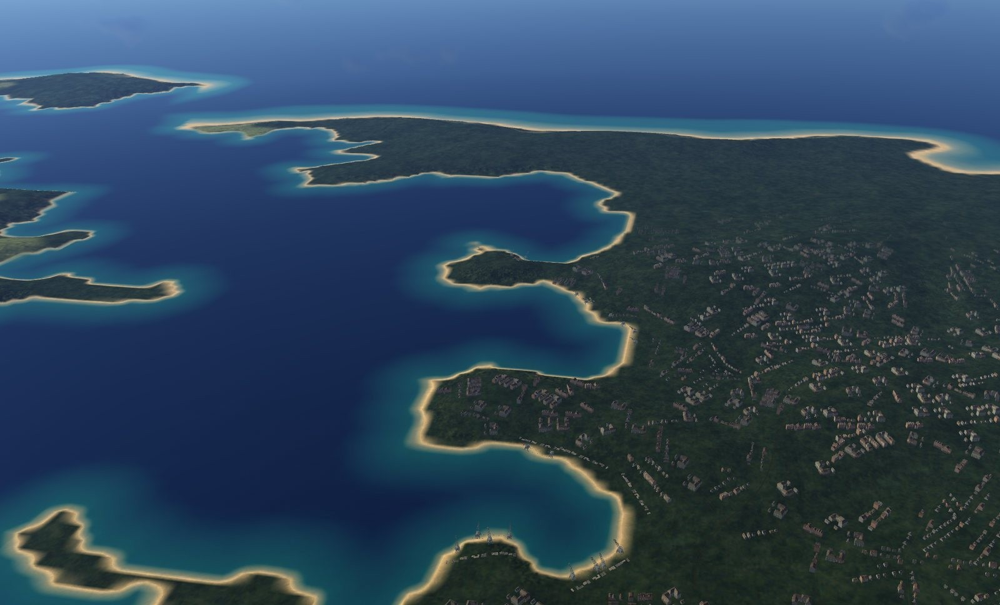 | A coast in game |
| 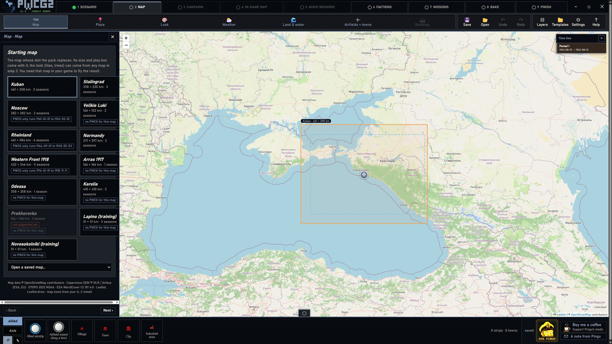 | Map tab: the starting map and its box over a real place |
| 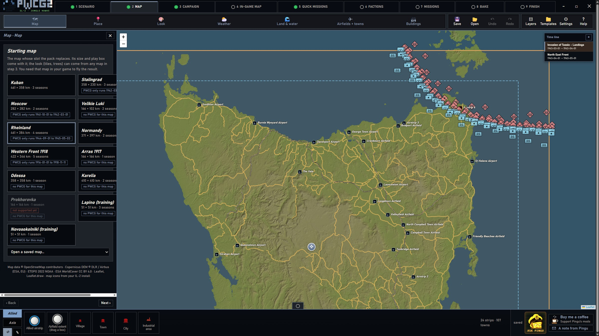 | Place tab: towns and settlement detail |
| 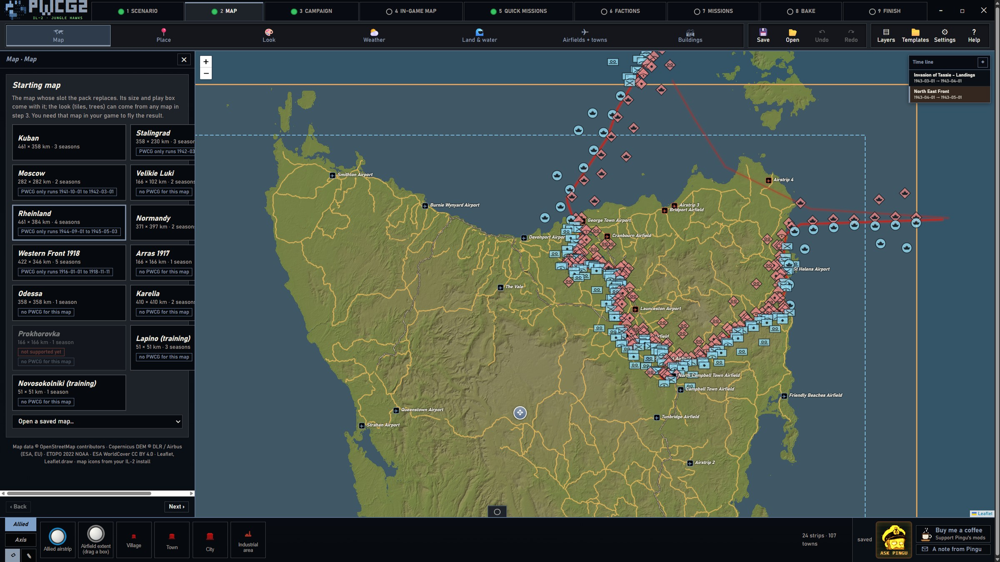 | Campaign: phases and front lines |
|  | Campaign: squadrons and their bases |
| 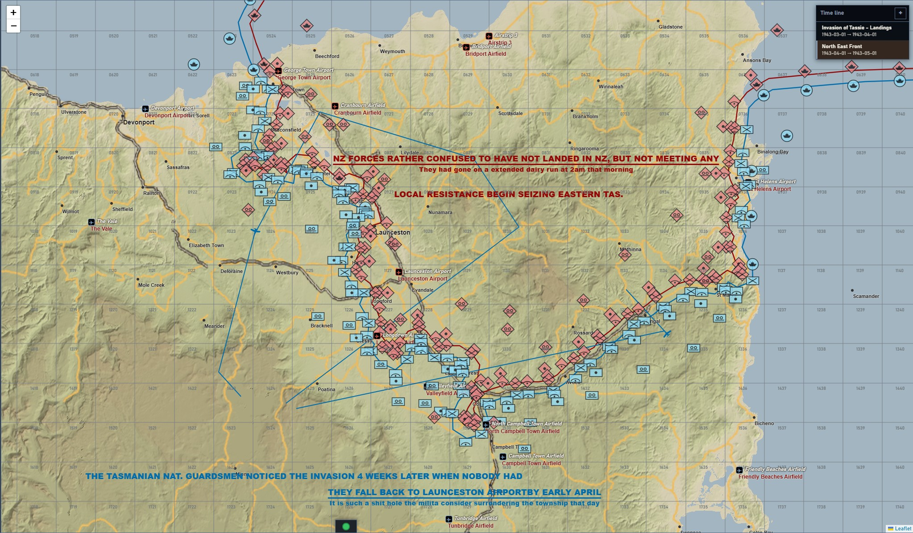 | In-game map art |
| 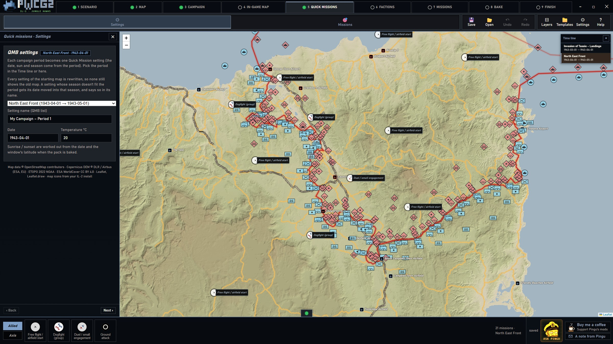 | Quick missions on the new map |
| 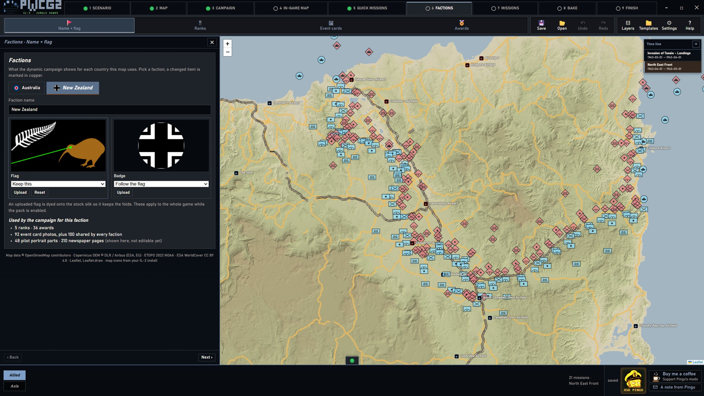 | Factions: flags, badges, ranks |
| 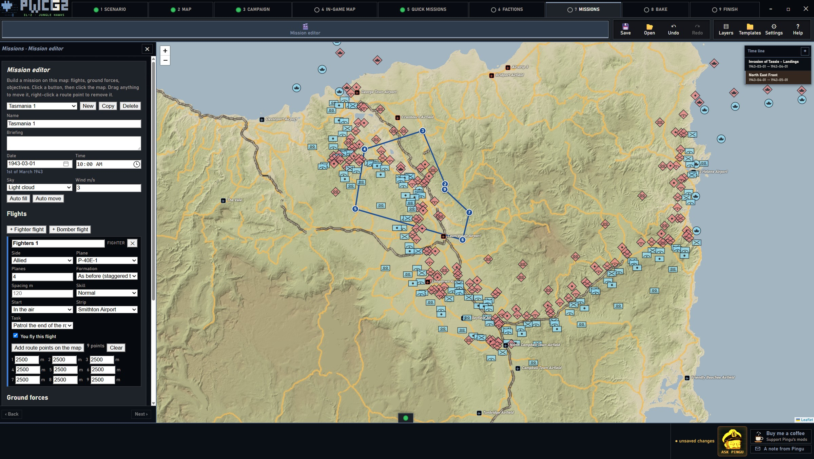 | Mission editor |
| 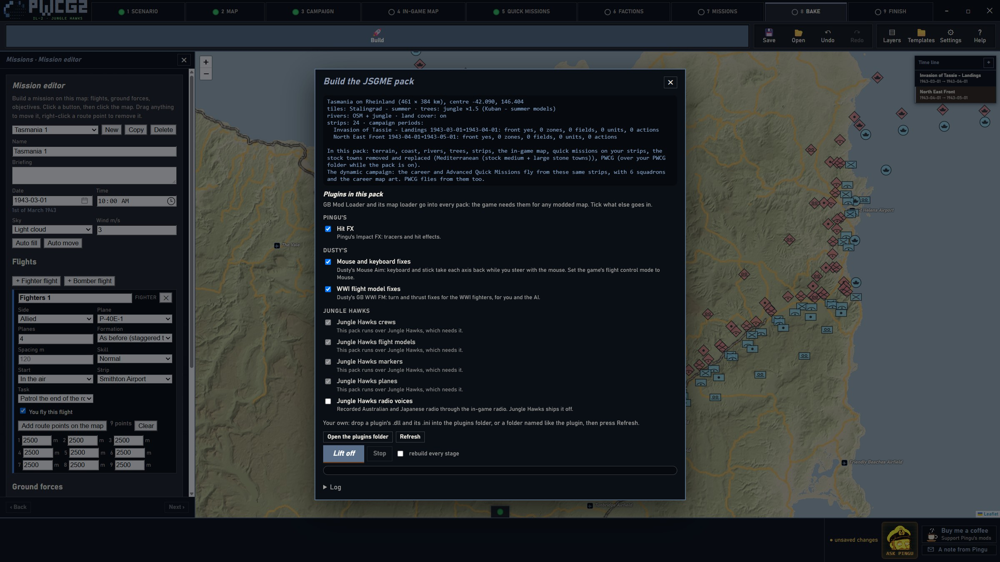 | Bake: a progress bar for every stage |
| 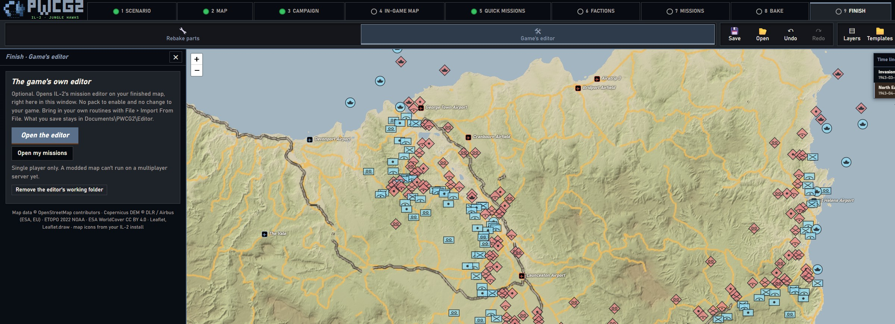 | Finish: the game's own editor |
| 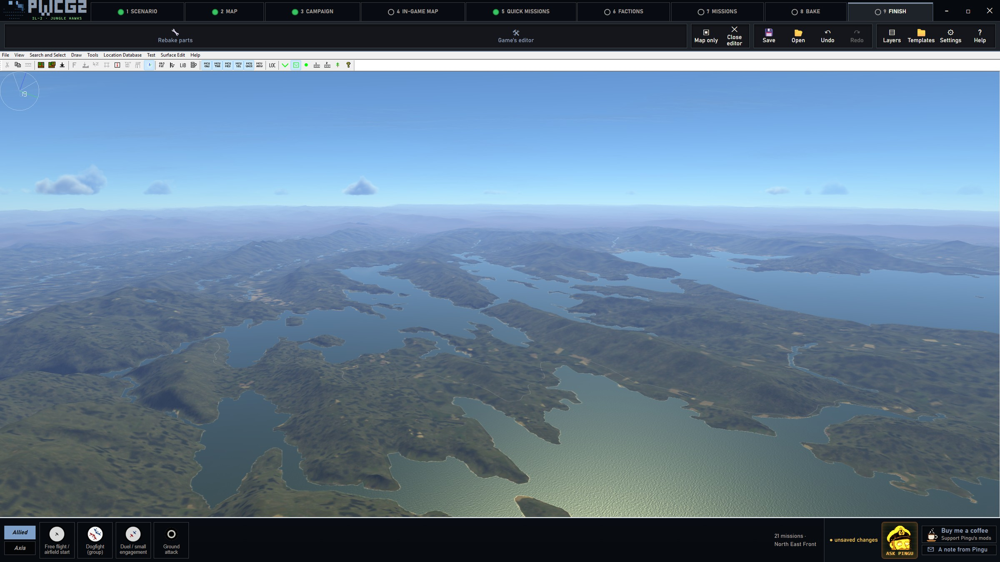 | The result in 3D |
